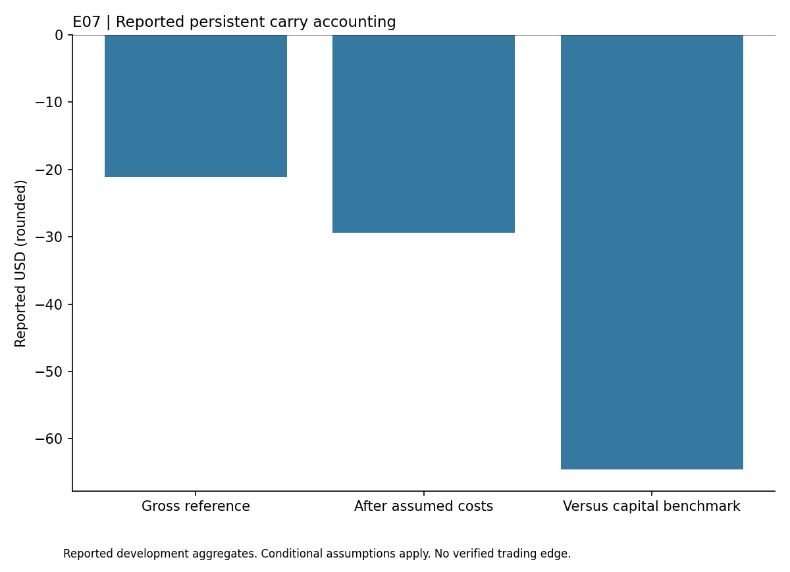

# Perpetual Carry

## Findings

This study evaluated one persistent position: a hypothetical 0.01 BTC oracle long proxy against an equal base BTC perpetual short. Entry was January 5, 2026 and exit was June 29, 2026. It used four assumed fills without weekly turnover or parameter fitting.

The recorded gross result was -$21.12. Assumed fees and slippage reduced it to -$29.43. Relative to the 4% annual capital opportunity benchmark, the shortfall was $64.52. The fixed development screen failed, and July to September 2026 remains sealed.

The oracle reference is not a price at which spot BTC could necessarily be bought. Candle opens were also not synchronized executable quotes. The calculation does not establish margin survival, liquidation behavior, custody safety or USD/USDC conversion costs.

## Reading this report

This public copy contains the findings of one completed development study. Its chart uses only the small aggregate table in [findings.json](findings.json). The original research history, raw observations, source datasets and reserved confirmation periods remain private. This copy does not reproduce a historical backtest or establish an independently confirmed strategy.

Install matplotlib in your own Python environment, then run `python plot_results.py` to regenerate the chart. The script reads the saved table and makes no network requests. These are reported findings from the original study, not a fresh evaluation. Passing an integrity check or reproducing this chart does not validate profitability.

The [public file manifest](PUBLIC_FILES.json) records hashes of the report, aggregate table, chart script and figure. This copy was prepared without the original Git history so personal commit email addresses are not exposed. It grants no rights to underlying third-party datasets.
